


 

 

I love building products. Not features for their own sake, but things that make one person's
annoying problem go away. Most of what's on this profile started as *"why is this so hard?"*,
became a one-page spec, and ended up shipped.

 



 


<table>
<tr>
<td width="50%" valign="top">

<a href="https://github.com/rajdeep-2004/strata"></a>

**Problem:** open-source codebases are hard to find your way around, and tools like Google
Code Wiki only cover repos someone already indexed. 
**Built:** a RAG assistant for *any* repo, public or private. Syntax-aware chunking,
3,072-dimension Gemini embeddings in Qdrant, and answers grounded only in retrieved code.
When it doesn't know, it says so.

`Next.js` `TypeScript` `Gemini` `Qdrant` `MongoDB` 
[**Live demo →**](https://strata-rose.vercel.app) · [Code](https://github.com/rajdeep-2004/strata)

</td>
<td width="50%" valign="top">

<a href="https://github.com/rajdeep-2004/proctra"></a>

**Problem:** exam tools either can't be trusted or treat students like suspects. 
**Built:** 16 features across teacher and student flows: custom marking (negative and
fractional), scheduled slots, a live leaderboard, crash-proof autosave, server-enforced timing
and auto-submit. No webcam video, no "suspicion score".

`Next.js` `Electron` `MongoDB` 
[**Live →**](https://proctra-mu.vercel.app) · [**macOS app →**](https://github.com/rajdeep-2004/proctra/releases/latest) · [Code](https://github.com/rajdeep-2004/proctra)

</td>
</tr>
<tr>
<td width="50%" valign="top">

<a href="https://github.com/rajdeep-2004/luna"></a>

**Problem:** practising engineering judgment is boring, so nobody does it daily. 
**Built:** predict the output, slay the buggy line, survive a production incident, duel
friends, and climb the ranks, five minutes at a time.

`Expo` `React Native` `Express` `MongoDB` 
[Code](https://github.com/rajdeep-2004/luna)

</td>
<td width="50%" valign="top">

<a href="https://github.com/rajdeep-2004/jmusic"></a>

**Problem:** switching to a browser tab for music breaks focus. 
**Built:** a keyboard-driven TUI that searches Jamendo and plays through a headless VLC,
with one runtime dependency.

`TypeScript` `Node.js` 
[Code](https://github.com/rajdeep-2004/jmusic)

</td>
</tr>
<tr>
<td width="50%" valign="top">

<a href="https://github.com/rajdeep-2004/loop"></a>

**Problem:** campus group chats sprawl across apps and never match schools, programs,
years and clubs. 
**Building:** idempotent sends, an offline outbox with retry, read markers, presence and typing.

`Expo` `Fastify` `Socket.IO` `MongoDB` 
[Code](https://github.com/rajdeep-2004/loop)

</td>
<td width="50%" valign="top">

#### Curious side quests

**[Handcrafted, Learned, or Both?](https://github.com/rajdeep-2004/fashion-image-classification-benchmark)** 
A leak-free ML study. A 241k-parameter CNN beats tuned HOG + SVM (92.09% vs 91.08%) at ~300× the speed.

`PyTorch` `scikit-learn`

**[DualPath](https://github.com/rajdeep-2004/dualpath)** 
Harvard vs shared-memory CPU design, compared cycle by cycle in Verilog, with every stall
shown on the waveform.

`Verilog`

</td>
</tr>
</table>

 



- **DevClub, Newton School of Technology** (founding member, now General Secretary): bootcamps, hackathons and
  *Tech Tuesdays*, a weekly newsletter that hit 750+ views in its first 30 days.
- **Product case finalist**: BITS Pilani *Product Paradox* (a 12-week, RICE-prioritised roadmap for PhonePe's
  trust-to-monetisation gap) and Masters' Union x SuperYou (go-to-market across 40+ personas).
- **Head of Product, Arthakram**, the campus product and consulting club.
- **Founding team, Hastakala**: user research with 10+ artisans that shaped onboarding for a pre-launch
  marketplace, plus requirements for its 5 core user flows.

 


  

<b>Product craft:</b> PRDs · user research · RICE · roadmaps · success metrics · go-to-market · Notion · Figma

 


  <picture>
    <source media="(prefers-color-scheme: dark)" srcset="https://raw.githubusercontent.com/rajdeep-2004/rajdeep-2004/output/snake-dark.svg"/>
    <source media="(prefers-color-scheme: light)" srcset="https://raw.githubusercontent.com/rajdeep-2004/rajdeep-2004/output/snake-light.svg"/>
    
  </picture>

  

  
  

  

 
<b>Make it, then get it to people.</b> Got a problem worth solving? <a href="mailto:rajdeepsanyal24@gmail.com">Tell me about it.</a>

